# Adaptive Traffic Signal Control with Deep Reinforcement Learning

<div align="center">

<!-- Render assigns the hostname on the first deploy. If yours differs, update the two
     links that point at it: the badge here and the one in the Live demo section. -->

<a href="https://marl-traffic-signal-control.onrender.com"></a>
&nbsp;
<a href="https://render.com/deploy?repo=https://github.com/Adityakumar1805/marl-traffic-signal-control"></a>

<sub>Free instance: if it has been idle for a while the first request takes about a minute to wake it (returning visitors see a "Waking up the server…" screen). Everything after that is real time.</sub>


<p>
  
  
  
  <a href="https://github.com/Adityakumar1805/marl-traffic-signal-control/actions/workflows/ci.yml"></a>
  
  
</p>

</div>

Four **Double + Dueling DQN** agents — one per junction of a 2 × 2 signalised grid — learn to
cut average waiting time by **15 % at light demand and 61 % at rush hour** against a fixed-time
controller. A safety finite-state machine makes conflicting greens impossible by construction,
and emergency preemption gets an ambulance through the grid up to **3.5× faster** (rush hour).
It runs on **SUMO** when SUMO is installed and on a **built-in point-queue simulator** when it
isn't, and ships a live web dashboard that races the learned policy against the fixed-time
baseline on the same traffic, arrival for arrival — drawn as Indian traffic (two-wheelers,
autos, e-rickshaws, buses, tractors…) driving on the left, with ambulances, police cars and
fire engines you can send in yourself and follow, junction by junction, on both grids.

<p align="center">
  
  <br>
  <sub>The live page at rush hour. An ambulance is sent into both grids and the page plays in its automatic slow motion
  (0.2×) until it is through, then pauses on the result. In this run it needs 35 simulated seconds to get through the RL
  Agent System and 136 through the traditional one (1:41 sooner, 3.9× faster); over the benchmark's three seeds the
  rush-hour figure is 3.5×. Recorded with <code>tools/record_gif.py</code> and played 2.5× faster than recorded.</sub>
</p>

```bash
python run.py demo              # dashboard on http://127.0.0.1:8000 — nothing else to configure
```

---

## 🚀 Live demo

### **<https://marl-traffic-signal-control.onrender.com>**

No install, no SUMO, no checkpoint to train — the hosted instance runs the same shipped
model as the local demo. Three things worth doing in the first minute:

1. Watch the queues. The page opens at **Rush hour**: on the Traditional Traffic System
   (right) the queues outgrow the road — a `+15` badge counts the cars that no longer fit on
   screen — while the RL Agent System (left) keeps them short. The average wait sits in each
   map's header, and the live result under the maps says by how much the RL agents are ahead.
2. Press **Send emergency vehicle** and choose an ambulance, a police car or a fire engine.
   The same vehicle enters *both* grids, the race drops to slow motion so you can follow it,
   and it is tracked on both: circled, labelled *Moving*, *Waiting* or *Not moving*, the light
   it waits at ringed and its route ahead dashed. The line above each map says what it is
   doing on that grid, junction by junction, and the tracker under the maps says which system
   has it further along. Once it is through both grids the race pauses for a moment on the
   result — which system got it through faster, and by how much — and **Timeline** lists
   every step.
3. Press **Pause**, and use **⋯ → Step one decision** around a light change to see the 3 s
   amber and the 2 s all-red the safety layer inserts.

The status at the top right says **Live** while the WebSocket is up.

It is a shared simulation, deliberately: whoever else has the page open sees the same
race and can press the same buttons. Deployment details, the free-tier caveats and how to
host your own copy are in **[docs/DEPLOYMENT.md](docs/DEPLOYMENT.md)**.

---

## Measured results

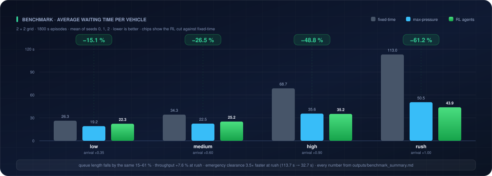

Three controllers × four demand levels × three seeds = **36 runs**, every row in
[`outputs/benchmark_results.csv`](outputs/benchmark_results.csv), aggregated in
[`outputs/benchmark_summary.md`](outputs/benchmark_summary.md). Measured on the built-in
point-queue simulator; the SUMO backend is implemented and unit-tested but was not used to
produce these numbers.

| Demand | Fixed-time | Max-pressure | **RL agents** | RL vs fixed-time |
|---|---:|---:|---:|---:|
| Low (arrival ×0.35) | 26.3 s | **19.2 s** | 22.3 s | −15.1 % |
| Medium (×0.60) | 34.3 s | **22.5 s** | 25.2 s | −26.5 % |
| High (×0.90) | 68.7 s | 35.6 s | **35.2 s** | −48.8 % |
| Rush (×1.00) | 113.0 s | 50.5 s | **43.9 s** | −61.2 % |

Averaged over the four demand levels the agents remove **38 %** of the waiting time. The gain
is smallest where there is least to win, and it is worth saying plainly that **max-pressure
beats the agents at low and medium demand** (19.2 s and 22.5 s against 22.3 s and 25.2 s).
The agents take the lead under congestion: they edge past max-pressure at high demand
(35.2 s against 35.6 s) and win clearly at rush hour — 43.9 s against 50.5 s, and 14.1 queued
vehicles per junction against 16.3. Against fixed-time at rush they also clear **7.6 % more
vehicles**.

Queue length falls in step with waiting time, −15.3 % to −61.3 %. Emergency clearance with
preemption is **1.3× faster at low demand and 3.5× faster at rush** (113.7 s → 32.7 s), the
case that actually matters for an ambulance.

<table>
<tr>
<td width="50%">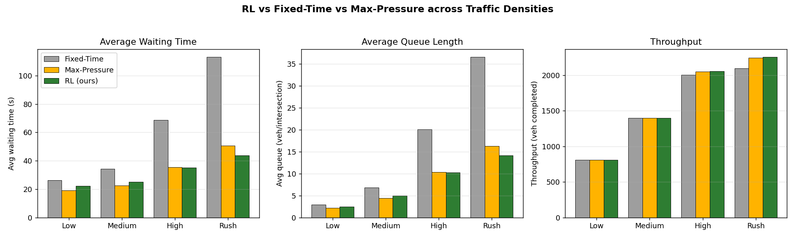</td>
<td width="50%">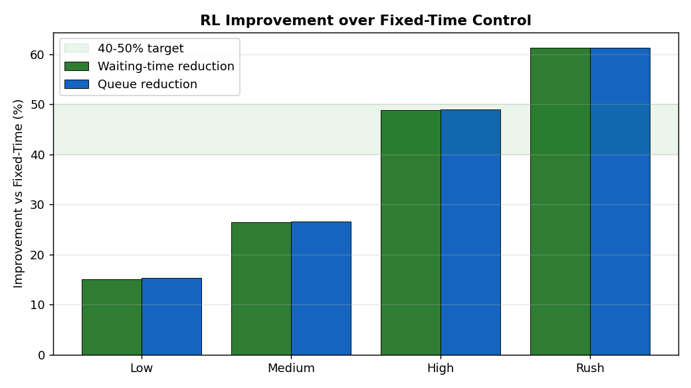</td>
</tr>
</table>

`python run.py eval` reruns all 36 episodes and overwrites both the CSVs and these plots.
The random seeds are fixed, so a rerun reproduces the table above rather than something
near it — [CI](.github/workflows/ci.yml) reruns it on every push, once with PyTorch and once
with the NumPy network the hosted site uses, and fails if a single byte of the CSVs changes.

---

## The dashboard

One page, the same four junctions twice, the same arrivals fed to both: the learned policy on
the left (*RL Agent System* on the page), the fixed-time controller on the right
(*Traditional Traffic System*). The page is written for people with no traffic or
machine-learning background. The two maps fill the screen, each with a line on top that says
what is happening on that grid; everything else is under them — the emergency tracker, the
live result, a chart of the run and three small tiles. It opens at rush hour, where the
difference between the two systems is largest.

![The whole page on a 1440-pixel-wide screen, paused on the result of an emergency test: the title and live status (paused on the result, 3 s), the controls in one row, the two 2x2 grids side by side with the average wait in each header and a line saying the ambulance is through in 0:42 on the RL grid and 2:27 on the traditional one; under them the tracker (RL Agent System got it through 3.5 times faster, 1:45 sooner), the live result (43.5 s against 80.7 s, 46 percent less waiting), the chart of the run, and the tiles for cars queued, trips completed and the emergency test](docs/screenshots/dashboard_desktop.png)

| Control / panel | What it does |
|---|---|
| **The two maps** | The race itself. Each map's header gives that system's average wait at red lights; the line under it describes the system, or — while an emergency vehicle is on the road — says where that vehicle is on this grid (see below). On a laptop the maps are as big as the screen allows |
| **Pause / Play · Restart** | Freeze or resume the run; Restart replays the same traffic from the start |
| **Traffic** | Light / Normal / Heavy / Rush hour (the `low` / `medium` / `high` / `rush` scenarios) — restarts the run with those arrival rates. The page opens at Rush hour; the busier the roads, the bigger the difference |
| **Speed** | A slider with six stops: 0.2× *very slow*, 0.5× *slow*, 1× *normal* (one 5 s decision per 200 ms tick, 25× real time), 2×, 4×, 8× *fastest* |
| **Send emergency vehicle** | Opens the choice — ambulance (east–west), police car (north–south) or fire engine (east–west) — and sends it into *both* grids at once (**E** opens the same menu). A refused dispatch (four already on the road) is explained in a message |
| **Slow motion and the pause on the result** | While an emergency vehicle is on the road the race plays at 0.2× so it can be followed, and the status at the top says *Slow motion until it is through*; choosing a speed yourself turns that off. Once a vehicle is through both grids the race stops for 5 s on the result, then carries on by itself (**Play** carries on at once) |
| **Live result** (under the maps) | Which system is ahead and by how much — *The RL Agent System is cutting waiting time by N%*, *The Traditional System is ahead right now, by N%*, *Both systems are about even right now*, or *Measuring the first two minutes…* — from the two average waits shown under it, and one sentence in seconds. The numbers describe the run on screen (one seed, still running), not the three-seed benchmark quoted under them: at rush hour the traditional system's queues keep growing, so the figure climbs over the 30-minute run |
| **Chart** | Waiting time or cars queued over the run so far; the area between the lines is shaded where the RL agents are ahead ("time saved by RL"); hover for the exact values at any minute |
| **Tiles** | Cars queued per junction as two bars on one scale, trips completed, and the result of the last emergency test with a link to its timeline |
| **⋯ More** | *Step one decision* (5 simulated seconds), the vehicle types on the road with live counts, and the technical details (model file, network, build, connection) |
| **? · ⛶** | How to read the page and the keyboard shortcuts; presentation mode (full screen) |

### Following an emergency vehicle

The question a viewer asks is simple — *is the ambulance moving, and where is it?* — so the
page answers it on the maps and in words, for every emergency vehicle on the road:

* **On both maps** it is circled by a pulsing ring with a label: *Ambulance · Moving*,
  *Waiting 0:12*, *Not moving 0:45* (no progress for 30 simulated seconds) or *Through in
  0:42*. The signal it waits at (or drives towards) is ringed in the colour it is showing, its
  route ahead to the edge of the grid is dashed with a ring on every stop line it still has to
  cross, a fading trail shows where it has just been, and the rest of the map is dimmed so it
  stands out (**Focus**, or **F**). When it leaves the grid, a *Through in 0:42* marker stays
  for ten seconds where it left.
* **Never lost from sight.** At rush hour a queue can hold more vehicles than the road on
  screen; a vehicle that waits too far back to be drawn — or drives onto a link already full
  of queued cars — is marked by a dashed ring on that queue's `+n` badge, and its label gives
  its place: *Ambulance · 18th in line · Moving*.
* **The line above each map** says the same in words, without scrolling: the status
  (*MOVING*, *WAITING 0:12*, *NOT MOVING*, *THROUGH*), the reason (*Green at J1_0 · 17
  vehicles ahead, clearing*, *Red light at J1_1 · first in line*, *Green requested at J1_1*,
  *Driving to J1_1*) and how far along its route it is (*Junction 1 of 2*).
* **The tracker** under the maps says which system has it further along (*RL Agent System is
  ahead · 1 junction further along (past J1_0)*) and has one row per grid: the status, the
  reason, the junction counter, a progress bar along its route with the junctions it has
  crossed, the time since it was sent and the time it has stood in queues. Once it is through
  both grids it says which system got it through faster and by how much (*RL Agent System got
  it through 3.5× faster · 1:45 sooner*), and it stays until you close it. **Timeline** (or
  **T**) lists every step with its time: sent, waiting at J1_0 and how far back, green
  requested, green light, crossed, out of the grid.

Every one of these facts comes from the simulator, not from the picture: the server sends,
for every emergency vehicle, the junction it waits at, its place in that queue (even beyond
what the browser is sent to draw), the link it drives on, its waiting time and age, and the
exact time it took to leave the grid; `tests/test_emergency_tracking.py` checks this feed
against the simulator at every frame and `tests/test_tracker_js.py` runs the page's tracker
in Node on a recorded rush-hour run and checks, frame by frame, that it places each vehicle
where the simulator has it, names the grid where it is further along and reports the
simulator's own clearance times. The tracker follows the frame the maps are showing, so the
words always match the picture.

<table>
<tr>
<td width="62%">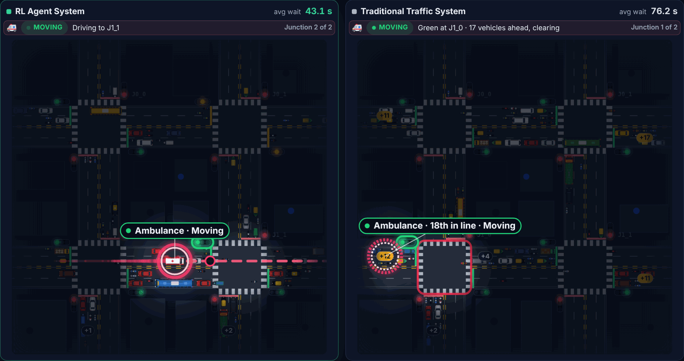</td>
<td width="38%">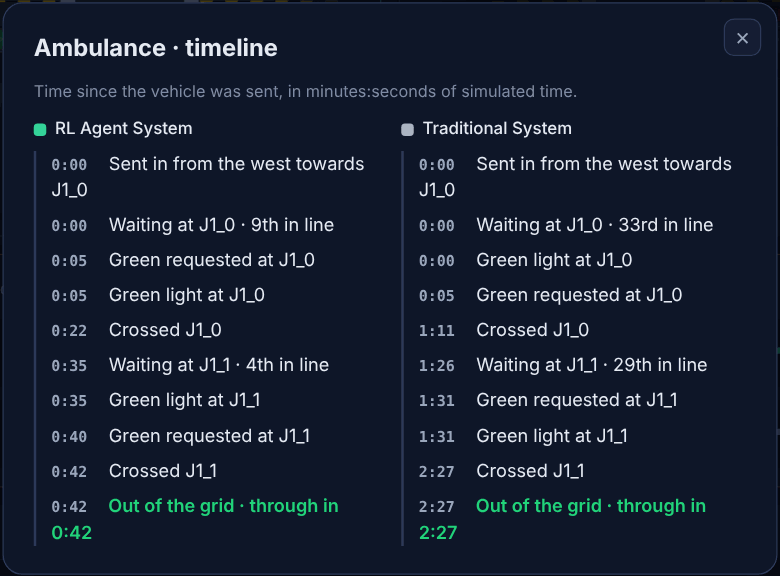</td>
</tr>
<tr>
<td colspan="2">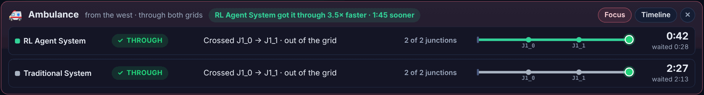</td>
</tr>
</table>

Colour means one thing each: green is the RL Agent System (and "better"), grey the
traditional system, rose emergencies; status dots are green (moving), amber (waiting) and red
(not moving); the lamps on the maps keep their real red, amber and green. The page is dark,
works with a keyboard alone (**Space** pause, **R** restart, **E** emergency vehicle, **F**
focus, **T** timeline, **?** help), and keeps its pulses, trails and beacons still under
*reduce motion*.

**What is drawn is exactly what is simulated.** Each vehicle has a kind from a configurable
Indian traffic mix (`traffic_mix` in `config.yaml`: about half two-wheelers, then cars,
autos and e-rickshaws, a few buses, trucks, tempos and tractors). Kinds are cosmetic — they
come from their own random stream, so changing the mix never changes the traffic or a
published number. The browser receives the moment every vehicle leaves a queue and enters
a link, and from those it reconstructs every queue, every vehicle on a link and every
vehicle crossing a junction for any instant between two frames; a test checks that this
reconstruction equals the simulator's real state second by second. Vehicles keep to the
left, slow vehicles to the kerb lane, two-wheelers pair up in a lane, and emergency
vehicles flash.

<details>
<summary><b>How the page talks to the server</b></summary>

* One WebSocket, `/ws`. The server sends a `hello` (geometry, vehicle catalogue,
  scenarios) and then one frame per 200 ms tick: a *keyframe* (full state) every 10 s or
  after a reset, otherwise a *delta* with only what changed — about 0.7 KB at medium 1×
  and 4 KB at rush 8×, against 8–11 KB for the full state.
* A heartbeat every 2 s while paused, a ping every 15 s, a 7 s watchdog, and reconnection
  with exponential back-off (0.5 s → 15 s, with jitter). A viewer that falls 25 frames
  behind is resynchronised with a keyframe instead of being sent a growing backlog.
* If WebSockets are blocked on the visitor's network, the page falls back to polling
  `/api/state` once a second (the status reads **Live · polling**) and keeps retrying the
  socket.
* Emergency vehicles have three fields of their own: `ed` (each dispatch: the same vehicle's
  id on both grids, its kind, when it was sent and the junctions on its route), `ev` (where
  each one is: queued at which approach and how far back, or on which link) and `evx` (the
  ones that have left, with the exact time it took). They are sent only when they change, and
  `am` says when the server is in its automatic slow motion or pausing on a result.
* A service worker caches the page so that a returning visitor sees **Waking up the
  server…** while a sleeping free instance boots, instead of a blank tab. It is network-first,
  so it never serves stale code while the server answers.
* Without FastAPI the project falls back to a zero-dependency standard-library server that
  serves the same page and polls.

</details>

<p align="center">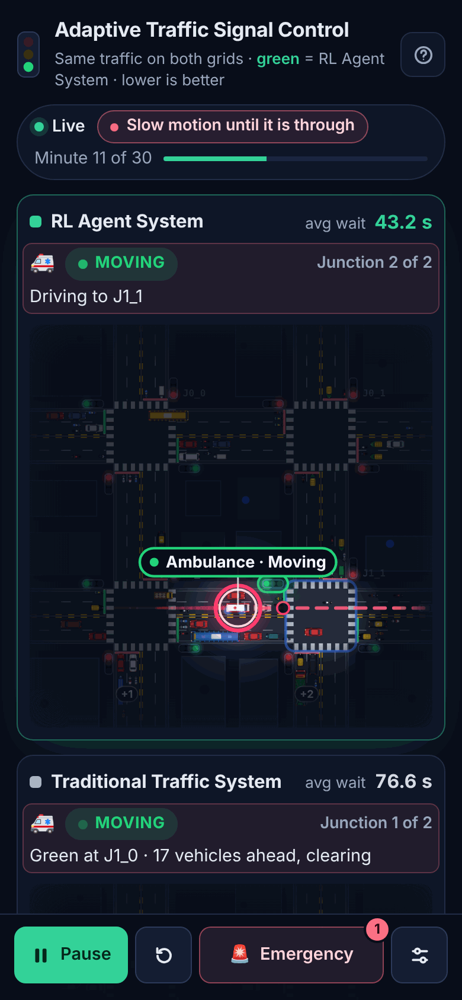</p>

On a phone the two grids sit one under the other, each with its own line, and the controls
move to a bar at the bottom; **Emergency** opens the same choice of vehicle.

---

## Fixed-time vs the learned policy

Both grids of the dashboard (*RL Agent System* and *Traditional Traffic System* on the page) receive
the *same* arrivals from the same seed, so every difference you see is the controller and
nothing else.

| | Fixed-time baseline | RL agents |
|---|---|---|
| Decides by | a clock: 30 s of NS, then 30 s of EW, forever | a 23-number observation, re-read every 5 s |
| Sees | nothing | its own 4 queues and waits, its phase, green-so-far, 4 emergency flags, and its neighbours' pressures and phases |
| Coordinates | not at all | through those neighbour features — no central controller, no message passing |
| Reacts to a surge | on the next scheduled turn | on the next 5 s decision |
| Reacts to an ambulance | the shared pre-emption override, once the vehicle is at a stop line | the same override, plus four emergency flags in its observation and a reward for clearing it |
| Waiting time at rush | 113.0 s | **43.9 s** |
| Code | [`control/fixed_time.py`](src/atsc/control/fixed_time.py) | [`control/rl_controller.py`](src/atsc/control/rl_controller.py) + [`agents/net.py`](src/atsc/agents/net.py) |

What the two share is the part that must not be negotiable: **both** drive the same safety
FSM, so both pay the same 3 s amber and 2 s all-red, and neither can produce a conflicting
green. The agents are not allowed to win by cheating the interlocks. One honest caveat:
`max_green_s: 60` ends a long green, but the FSM also accepts a new request during the amber
and all-red, so a controller that keeps asking for the same phase can cancel the change and
keep a side street waiting longer (up to about 113 s in the benchmark runs) — see
[Known limitations](#known-limitations).

A third controller, **max-pressure**, is in the benchmark but not on the dashboard. It
beats the agents at low and medium demand; the results table above says so out loud.

---

## Technology stack

| Layer | Choice | Fallback if absent |
|---|---|---|
| Learning | PyTorch 2.2 (Double + Dueling DQN, prioritized replay) | a from-scratch NumPy dueling net with manual backprop |
| Simulation | SUMO 1.18+ through TraCI | a built-in point-queue simulator behind the same interface |
| Web server | FastAPI + `uvicorn[standard]`, WebSocket push of compact deltas | `http.server` from the standard library, polling |
| Frontend | hand-written HTML, CSS and `<canvas>` JavaScript in ES modules; all 18 vehicle sprites drawn in code | — (there is no framework and no CDN to lose) |
| Numerics | NumPy 1.26, pandas + matplotlib for the benchmark plots | — |
| Config | one `config.yaml`, read by every module | — |
| Tests | pytest, 172 tests (environment, safety FSM, reward, replay, controllers, benchmark maths, wire protocol, servers, vehicles, page and emergency tracking), run by GitHub Actions on every push, and a Playwright browser check | — |
| Hosting | Render free plan, defined in [`render.yaml`](render.yaml) | the same [`Dockerfile`](Dockerfile) on Spaces / Fly / Railway |

Three of those fallbacks are load-bearing rather than decorative: the hosted site runs
**without torch**, on the NumPy network loading the same checkpoint, which is what keeps
it inside a 512 MB free instance.

---

## Quickstart

**Windows**

```bat
run.bat
```

**macOS / Linux**

```bash
./run.sh
```

The launcher creates a virtual environment, installs the pinned dependencies, loads the
shipped pre-trained checkpoint, starts the dashboard and opens
**http://127.0.0.1:8000**. SUMO is not required — the built-in simulator takes over
automatically and the launcher prints how to install SUMO if you want the microscopic view.

<details>
<summary><b>Manual and advanced usage</b></summary>

```bash
pip install -r requirements.txt

python run.py doctor         # environment and dependency check, prints what is missing
python run.py demo           # train-if-needed, then open the live dashboard
python run.py train --quick  # 8 episodes, under a minute on a CPU -> models/pretrained/atsc_2x2_quick.pt
python run.py train --overwrite  # full 112-episode curriculum (~2 CPU minutes); REPLACES the shipped model
python run.py eval           # 36-run benchmark -> outputs/*.csv, summary and KPI plots
python run.py eval --backend sumo   # the same benchmark on SUMO -> outputs/sumo/
python run.py sim            # watch the trained policy in SUMO-GUI (needs SUMO)
pytest                       # 172 tests (without Node.js the browser-script tests skip themselves)
python tools/e2e_browser.py --local   # headless-browser check of the dashboard (needs playwright)
```

Every one of these reads `config.yaml`; the few flags above only choose *what* to run, and
any command accepts `--debug` to print a full traceback. A plain `train` refuses to
overwrite the shipped checkpoint (and the training log the README quotes) unless you pass
`--overwrite`.

</details>

---

## How it works


One loop, five stages, and a closed feedback path. `config.yaml` is the only source of
numbers. The simulator is either SUMO through TraCI or the built-in point-queue model behind
the identical interface. Every 5 s of simulated time each junction produces a 23-number
observation, its agent asks for a phase, the safety layer decides whether that request is
legal, and the lamp state it produces is what advances the simulation to the next decision.

### What one agent computes


23 numbers in, 2 Q-values out, **19,971 parameters** in total. The observation is 4 queue
lengths + 4 waiting times + a 2-way phase one-hot + green-time-so-far + 4 emergency flags +
4 neighbour pressures + 4 neighbour phases. Those last eight are what make the agents
coordinate: there is no central controller and no message passing, only each junction
seeing what its neighbours are holding. All four agents share one set of weights and one
prioritized replay buffer, so every junction's experience trains the same policy.

### Why conflicting greens are impossible


The agent never writes to the lamps. It writes a *request*, and the finite-state machine in
`src/atsc/envs/phases.py` decides what happens: a request arriving before minimum green is
ignored, a phase reaching maximum green is switched whether the agent asked or not, and
every change pays a mandatory 3 s amber plus 2 s all-red. Conflicting greens are unreachable
states rather than states we try to avoid — `tests/test_phases_safety.py` hammers the machine
with randomised requests over 18,000 steps and asserts the invariant holds every step.

Emergency preemption sits on top of the same gate: the corridor is forced, never faked, so
an ambulance still gets its amber and all-red before the cross street loses its green.

---

## What makes it more than a tutorial DQN

| Differentiator | How it is delivered |
|---|---|
| **Multi-agent, multi-intersection** | One Double + Dueling DQN per junction on a 2 × 2 grid (`grid_rows`/`grid_cols` scale it), each observing its neighbours, so green-waves emerge instead of being scripted |
| **Safety by construction** | The phase FSM owns the lamps; the policy only makes requests. Unit-tested over 18,000 randomised steps |
| **Emergency preemption** | Detected at the stop line, corridor forced through the same safety gate, clearance time measured as a KPI; ambulance, police car and fire engine on the dashboard, each tracked junction by junction on both grids |
| **Honest benchmarking** | Not just fixed-time: also **max-pressure**, a controller that is near-optimal for throughput — and it wins at low demand, which the results report says out loud |
| **Runs on any machine** | SUMO ↔ built-in simulator, PyTorch ↔ a from-scratch NumPy dueling network with a portable checkpoint format, FastAPI ↔ a stdlib HTTP server. Three fallbacks, one behaviour |
| **Reproducible** | One seed in `config.yaml`, fixed evaluation seeds, tracked CSVs. `run.py eval` regenerates the published numbers byte for byte from the shipped checkpoint, and CI checks that on every push (retraining does not reproduce them — see [Known limitations](#known-limitations)) |

---

## Repository map

```
run.py · run.bat · run.sh        one entry point, two one-click launchers (pick Python 3.10-3.12)
config.yaml                      every number the project uses, in one place
requirements.txt · environment.yml · pytest.ini
asgi.py · render.yaml            hosted deployment: entrypoint + Render Blueprint
Dockerfile · Procfile · requirements-deploy.txt (every package pinned)
CHANGELOG.md                     release notes
.github/workflows/ci.yml         CI: the tests, the benchmark reproduced byte for byte, the hosted stack

src/atsc/
  config.py · seeding.py · logging_utils.py    config loading, determinism, logs
  vehicles.py  vehicle catalogue: 18 Indian vehicle types, traffic mix, emergency types
  sim/         SUMO backend, built-in point-queue simulator, net generator, SUMO autodetect
  envs/        traffic_env.py (multi-agent env) · phases.py (safety FSM) · spaces.py (observations)
  agents/      dueling DQN, prioritized replay, Double-DQN learner, Torch and NumPy nets, QMIX
  control/     fixed-time · max-pressure · RL · emergency preemption
  train/       curriculum trainer and checkpointing
  eval/        the 36-run benchmark harness, metrics, plots
  dashboard/   session.py (the race + wire protocol) · server.py (FastAPI/WebSocket) ·
               stdlib_server.py (fallback) · runtime.py, assets.py (headers, static files,
               page templating shared by both servers) · static/ (index.html, styles.css,
               sw.js, js/: main, transport, model, renderer, sprites, charts, tracker, ui)

models/pretrained/atsc_2x2.pt    the shipped checkpoint: 313 KB, 112 training episodes
tests/                           172 tests: environment, safety, reward, replay, controllers,
                                 benchmark maths, wire protocol, servers, vehicles, page and
                                 emergency tracking
tools/                           e2e_browser.py (Playwright check) · bench_server.py (tick/payload/load)
                                 · record_gif.py (the animation at the top)
outputs/                         the CSVs, summary and plots this README quotes — tracked on purpose
docs/assets/ · docs/screenshots/ the diagrams, stills and animation above
```

---

## Explaining it in a viva

A map from the question to the file that answers it.

| Asked | Point to | One-line answer |
|---|---|---|
| Where is the RL *environment*? | `envs/traffic_env.py` | PettingZoo-style parallel multi-agent env; `step()` advances 5 s and returns one reward per junction |
| What is the *state*? | `envs/spaces.py` | 23 numbers: queues, waits, phase one-hot, green-so-far, emergency flags, and neighbour pressures and phases |
| What is the *action*? | `envs/phases.py` | the target green phase — a request, not a command |
| How is *safety* guaranteed? | `envs/phases.py` (`SignalFSM`) | min/max green + mandatory amber + all-red; conflicting greens are unreachable, verified over 18,000 randomised steps |
| What is the *reward*? | `envs/traffic_env.py` `_rewards()` | −delay − pressure − switch penalty + emergency bonus; exact maths in [REPORT.md](REPORT.md) §4.3 |
| Which *algorithm*? | `agents/double_dqn_agent.py`, `agents/net.py` | Double + Dueling DQN, prioritized replay, target network, Huber loss, gradient clipping |
| Why *multi-agent*? | `agents/multi_agent.py` | one policy per junction, shared weights, neighbour-aware — coordination without a central controller |
| How does it *coordinate*? | `envs/spaces.py` | the eight neighbour features; no message passing, no central agent |
| *Emergency* handling? | `control/emergency.py` | preemption forces the serving phase, still through the safety FSM |
| How is an emergency vehicle *followed* on the page? | `dashboard/session.py` (`ev`, `evx`, `ed`), `static/js/tracker.js` | the server reports where each one is in the simulator; the page turns that into the labels, the line above each map and the tracker |
| Your *baselines*? | `control/fixed_time.py`, `control/max_pressure.py` | an honest fixed 30 s split, and max-pressure — which beats the agents at low demand |
| How do you *prove* the improvement? | `eval/benchmark.py` | identical seeds, three replicates, per-scenario improvement table and plots |
| No *SUMO*? | `sim/mini_backend.py` | built-in point-queue simulator behind the same interface; the demo still runs |
| No *PyTorch*? | `agents/net.py` | from-scratch NumPy dueling network with manual backprop and a portable checkpoint format |

The long form — verified file inventory, known weaknesses, and 144 questions with answers —
is in [docs/VIVA_MASTER.md](docs/VIVA_MASTER.md).

---

## Configuration

Every module reads [`config.yaml`](config.yaml). Change values, not code.

```yaml
network:   { grid_rows: 2, grid_cols: 2, link_length_m: 200 }   # 3x3 works — retrain first
signal:    { decision_interval_s: 5, min_green_s: 10, max_green_s: 60, yellow_s: 3, all_red_s: 2 }
demand:    { base_arrival_vps: 0.10, arterial_boost: 2.2 }      # the E-W arterial carries 2.2x
rl:        { algo: double_dueling_dqn, neighbor_obs: true, share_parameters: true }
reward:    { w_wait: 1.0, w_pressure: 0.30, w_switch: 0.20, w_emergency: 5.0 }
emergency: { enabled: true, preemption: true, types: { ambulance, police, fire } }
traffic_mix: { bike: 30, scooter: 22, car: 15, auto: 10, ... }  # cosmetic: what is drawn
dashboard: { default_scenario: rush, tick_ms: 200, speeds: [0.2, 0.5, 1, 2, 4, 8],
             emergency_slow_motion: 0.2, emergency_result_pause_s: 5, max_clients: 100 }
qmix:      { enabled: false }        # stretch goal: centralised training, decentralised execution
seed: 42
```

The safety numbers are enforced by the environment, not learned and not negotiable: the
agent cannot ask for a 4 s green, and no configuration makes the amber optional. The
shipped checkpoint only fits the `rl` / `network` settings it was trained with; change
those and loading it stops with a message naming the mismatch and how to retrain.

---

## Troubleshooting

| Symptom | Fix |
|---|---|
| "Python not found" | Install Python 3.10–3.12 and tick *Add to PATH* |
| You only have Python 3.13+ | The pinned PyTorch 2.2.2 / NumPy 1.26.4 have no wheels for it; install 3.12 alongside (the launchers pick it up, or `PYTHON=python3.12 ./run.sh`) |
| `./run.sh: Permission denied` | `chmod +x run.sh` (or `bash run.sh`) |
| The dashboard did not open | Browse to <http://127.0.0.1:8000> manually |
| "No trained model" | `python run.py train --quick` — under a minute on a CPU |
| Port 8000 is busy | Change `dashboard.port` in `config.yaml` |
| You want the SUMO view | Install SUMO 1.18+, set `SUMO_HOME`, then `python run.py doctor` |
| The live demo takes ~a minute to load | Expected: the free instance sleeps after 15 min idle. Returning visitors see "Waking up the server…" and the page connects by itself |
| The status says **Live · polling** | WebSockets are blocked on your network (proxy, VPN, antivirus); the page polls instead and keeps retrying the socket |
| "RL checkpoint does not match config.yaml" | You changed an `rl` / `network` setting the shipped model depends on: change it back, or `python run.py train --quick` |
| Your own deploy fails building numpy | Set `PYTHON_VERSION=3.12.6` — `render.yaml` already does |
| Anything else | `python run.py doctor` prints exactly what is missing and what it fell back to |

---

## Deploy your own live copy

The dashboard is one long-lived Python process: FastAPI serves the page, a JSON API and a
WebSocket, and an `asyncio` task advances the race every 200 ms and pushes a compact frame
to every browser. That rules out GitHub Pages (it cannot execute Python) and serverless
functions (an invocation cannot hold a WebSocket open or keep the broadcaster alive between
requests). It wants a small always-on container.

**Render's free plan** is the fit: WebSockets work, no card is needed, and it redeploys
on every push to `main`. The service is defined in code, so there is nothing to fill in
by hand:

```yaml
# render.yaml
buildCommand: pip install -r requirements-deploy.txt
startCommand: uvicorn asgi:app --host 0.0.0.0 --port $PORT --ws-max-size 65536 --ws-ping-interval 20 --ws-ping-timeout 20
healthCheckPath: /healthz
autoDeploy: true
```

Render dashboard → **New +** → **Blueprint** → pick this repository → **Apply**. Two to
four minutes later the URL is live, and `git push` is the whole deploy process from then
on.

| File | What it is for |
|---|---|
| [`asgi.py`](asgi.py) | the entrypoint. `build_app()` is a factory, so the package has no module-level `app`; this exposes one without calling `uvicorn.run()` or opening a browser |
| [`requirements-deploy.txt`](requirements-deploy.txt) | the runtime set with **every package pinned**, transitive ones included (38, all binary wheels). **No torch**: the NumPy network loads the same checkpoint |
| [`render.yaml`](render.yaml) | the Render Blueprint, free plan, auto-deploy from `main`, Python pinned to 3.12.6, health check on `/healthz` |
| [`Dockerfile`](Dockerfile) | Hugging Face Spaces, Fly.io, Railway or `docker run`; non-root, `${PORT:-7860}`, `HEALTHCHECK` |
| [`Procfile`](Procfile) | one line, for platforms that look for it |

`requirements.txt` still installs the full development set. Measured on the deploy stack
(`pip install -r requirements-deploy.txt`, Python 3.12.6): about **76 MiB** resident at idle
and **101 MiB** with 100 viewers connected, against a 512 MiB free instance; about **1.5 %**
of one CPU core at idle and **17 %** with 100 viewers (the free instance has 0.1 CPU); one
tick costs about **2–3 ms** at 1× (medium or rush hour) and **12–16 ms** at rush 8×,
against a 200 ms budget. `GET /healthz` reports the live numbers (version, build, viewers,
tick cost, payload size, CPU, memory).

The full walkthrough — the platform comparison, the Hugging Face Spaces alternative, the
environment variables, the post-deploy checklist, the free-tier caveats and what to do if
the status does not say **Live** — is in
**[docs/DEPLOYMENT.md](docs/DEPLOYMENT.md)**.

---

## Documentation

| File | What is in it |
|---|---|
| [REPORT.md](REPORT.md) | The methodology: MDP formulation, reward derivation, training protocol, full result tables |
| [EXPLAINER.md](EXPLAINER.md) | Plain-language walkthrough of every module and why it exists |
| [CHEATSHEET.md](CHEATSHEET.md) | The demo script and the numbers worth knowing by heart |
| [docs/DEPLOYMENT.md](docs/DEPLOYMENT.md) | Hosting the live dashboard: platform choice, exact steps, verification checklist |
| [docs/VIVA_MASTER.md](docs/VIVA_MASTER.md) | File-by-file verification, honest weaknesses, 144 questions with answers |
| [CHANGELOG.md](CHANGELOG.md) | Release notes |

---

## Known limitations

Stated plainly, because a reviewer will find them anyway. The first three live in code that
is deliberately left as it is — the safety FSM and the trained model — because every
published number depends on them; fixing them means retraining and re-benchmarking.

* **The FSM accepts a new request during amber and all-red.** Conflicting greens still
  cannot happen (that invariant is tested), but a controller can cancel a phase change
  mid-clearance and return to the same phase. With the shipped policy about one change in
  five is cancelled this way, and the longest wait of a side street for its green reached
  about 113 s in the benchmark runs, although `max_green_s` is 60.
* **Greens after the first are one second longer than configured** (11–61 s instead of
  10–60 s): an off-by-one in `phases.py`.
* **Training treats the time limit as a true ending** (no bootstrapping on the last
  transition), and **retraining is not bit-reproducible across NumPy versions** — the same
  112-episode recipe gave a different model on NumPy 2.x than on the pinned 1.26. The
  published numbers come from the one shipped checkpoint and regenerate exactly from it.
* **Pre-emption reacts at the stop line**, not on approach: an emergency vehicle joins the
  back of a queue and is only served once it reaches the front. The same override runs on
  both grids, as in the benchmark.
* **The fixed-time baseline is close to saturation at rush hour** (its east–west green can
  move about 0.21 vehicles/s against 0.22 arriving), so the −61 % at rush says as much about
  the baseline as about RL; max-pressure is the fairer comparison and the table reports it.
* **The built-in simulator is a point-queue model**: no spill-back, no car-following, no
  lane changing. Lanes, turns and vehicle types on the dashboard are drawn from the
  simulated queues and links, not simulated individually.
* **Some observation features saturate**: the waiting-time inputs reach their 1.0 cap on a
  quarter to a third of busy approaches in heavy traffic.

---

## Licence

MIT — see [LICENSE](LICENSE).

Built by **Aditya Kumar**.
